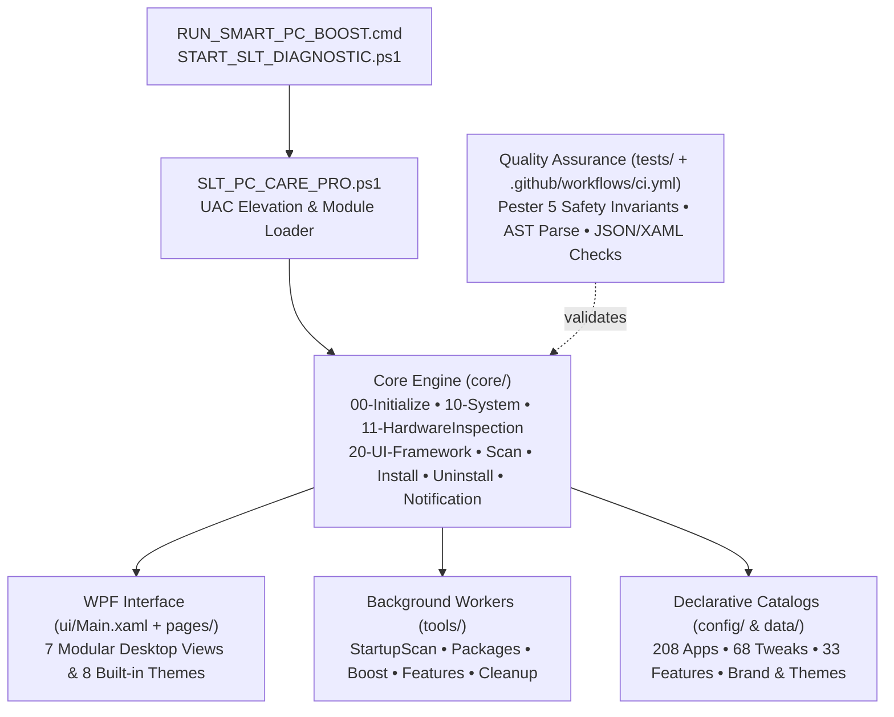

<div align="center">
  
  <h1>SLT Smart PC Boost</h1>
  <p><strong>Open-Source Windows 10/11 Hardware Inspection, Safe Maintenance &amp; Software Management Toolkit</strong></p>
  <p><em>Developed by Shahzad Babar &bull; Smart Life Teck (SLT) &mdash; Smarter Your Digital Life</em></p>

  <p>
    <a href="LICENSE"></a>
    
    
    
    <a href="CONTRIBUTING.md"></a>
    
  </p>
</div>

---

## Overview

**SLT Smart PC Boost** is a modular, open-source Windows desktop application engineered with **Windows PowerShell 5.1** and **WPF/XAML**. It combines hardware telemetry and technician-led quality-control (QC) workflows, a curated WinGet/package manager, reversible Windows optimization controls, an offline-capable web & AI tools hub, and safety-hardened backup/Sysprep helpers inside a single, readable, zero-compile codebase.

### Educational & Team Training Mission

Beyond day-to-day PC diagnostics and maintenance, SLT Smart PC Boost is intentionally structured as an **open-source learning laboratory** for students, IT technicians, and small-business technical teams:

- **Readable, Modular Architecture:** Every subsystem (`core/`, `pages/`, `tools/`, `config/`, `data/`, `ui/`) is plain-text PowerShell, XAML, and JSON—no opaque binaries or proprietary build lock-in.
- **Safety-First Engineering Patterns:** Demonstrates practical Windows security hygiene (PBKDF2-HMAC-SHA1 salted PIN hashing, NTFS ACL hardening on `ProgramData`, typed registry backup/rollback, BitLocker-safe Sysprep verification, and read-only duplicate detection).
- **Automated Verification Culture:** Ships with a **Pester 5** static safety invariant suite and a **GitHub Actions** Windows CI pipeline so learners practice test-driven safety checks on every pull request.

> **Project Status & Transparency Notice:** SLT Smart PC Boost is under active open-source development (`v1.0.0`). The Phase 1 Security Hardening patch eliminates unsafe silent modifications and enforces strict rollback and QC truth guarantees. End-to-end physical hardware validation across diverse Windows 10/11 builds is ongoing—always test system-changing features in a VM or non-production machine first. See [`docs/PHASE1_SECURITY_HARDENING.md`](docs/PHASE1_SECURITY_HARDENING.md) for the exact audit log.

---

## Architecture



For a deep-dive technical walkthrough of every module, see [`docs/ARCHITECTURE.md`](docs/ARCHITECTURE.md).

---

## Core Modules & Capabilities

| Module | Source File | Highlights |
| :--- | :--- | :--- |
| **1. Dashboard** | `pages/01-Dashboard.ps1` | Live system telemetry overview, quick health status, and unified navigation across all 7 modules. |
| **2. Smart Install & Uninstall** | `pages/02-Install.ps1` | Curated catalog of **208 official applications** (`data/applications.json`), instant background startup scan, safe WinGet installs/uninstalls (no forced wildcards, preserves `Microsoft.WinGet.Source`). |
| **3. Smart Tools Hub** | `pages/03-ToolsHub.ps1` | Categorized directory of **104 productivity, developer, and AI web tools** plus offline HTML hub (`assets/slt-ultimate-hub-final.html`). |
| **4. Boost & Optimization** | `pages/04-Boost.ps1` | **68 Windows tweaks** (`data/tweaks.json`) and **33 optional features** (`data/feature.json`) with typed registry backup/rollback, Recycle Bin confirmation, and preserved Prefetch/Windows Update caches. |
| **5. Backup & Sysprep Factory** | `pages/05-Backup.ps1` | DISM image helpers and hardened Sysprep/Unattend preparation: never decrypts BitLocker (`manage-bde -off` removed), protects external `Panther\unattend.xml` files, and archives logs instead of deleting them. |
| **6. Hardware Inspection & QC** | `pages/06-HardwareInspection.ps1` | Honest hardware telemetry (`Not reported` instead of fake fallbacks), explicit technician-gated QC checks (keyboard, charger, chassis), masked serials, and printable HTML/Excel A4 QC reports. |
| **7. Support & Brand Hub** | `pages/07-Support.ps1` | Configurable organization branding (`config/brand.json`), 8 built-in themes (`config/themes.json`), and official support channels. |

---

## Safety-First Engineering (Phase 1 Hardening)

SLT Smart PC Boost follows strict, test-enforced safety invariants documented in [`docs/PHASE1_SECURITY_HARDENING.md`](docs/PHASE1_SECURITY_HARDENING.md):

- **Truthful Telemetry:** Unreadable hardware sensors remain `Not reported`; incomplete manual QC checks remain `Pending / Not tested` (never auto-passed).
- **Zero Hardcoded Credentials:** Local staff access PINs use salted **PBKDF2-HMAC-SHA1** derivation with NTFS ACLs restricted to `SYSTEM`, `Administrators`, and the current operator.
- **Reversible Optimization:** Registry changes record original value types for accurate restoration; failed rollback entries are retained rather than discarded.
- **BitLocker & Sysprep Protection:** OS volume decryption is forbidden; BitLocker status is explicitly verified before any Sysprep operation, and external `Panther\unattend.xml` files are never overwritten.
- **Zero Silent Destruction:** Duplicate-file detection is read-only; Public Desktop shortcuts, Windows Prefetch, Windows Update download caches, and Mark-of-the-Web flags are never silently stripped.

---

## Requirements

- **OS:** Windows 10 or Windows 11 (64-bit recommended)
- **Runtime:** Windows PowerShell 5.1 (built into Windows; WPF desktop UI targets Windows PowerShell 5.1)
- **Privileges:** Administrator elevation (UAC) for system-wide inspection, software installs, or optimization actions
- **Network:** Required only for online package installs (WinGet) or web tool links; core UI and local diagnostics run completely offline with **no API key required**

---

## Quick Start

### 1. Clone or Download
```powershell
git clone https://github.com/Smartlifeteck/SLT-Smart-PC-Boost-v1.git
cd SLT-Smart-PC-Boost-v1
```

### 2. Launch the Desktop Application
Double-click **`RUN_SMART_PC_BOOST.cmd`** (or run from PowerShell):
```powershell
powershell.exe -NoProfile -STA -ExecutionPolicy Bypass -File .\START_SLT_DIAGNOSTIC.ps1
```
Approve the Windows UAC prompt when using administrator-level features.

### 3. CLI Diagnostic Mode (No GUI)
Inspect hardware telemetry and driver health directly in the console:
```powershell
powershell.exe -NoProfile -ExecutionPolicy Bypass -File .\SLT_PC_CARE_PRO.ps1 -DiagnosticOnly
```

---

## Automated Testing & CI Verification

Every push and pull request is automatically validated on `windows-latest` via [`.github/workflows/ci.yml`](.github/workflows/ci.yml), which runs JSON validation, XAML XML validation, PowerShell AST syntax parsing across all `.ps1` scripts, PSScriptAnalyzer checks, and the full Pester 5 test suite.

To run all tests locally on Windows:
```powershell
# Install Pester 5 if not already installed
Install-Module -Name Pester -MinimumVersion 5.0.0 -Scope CurrentUser -Force

# Run Phase 1 Safety Invariants & Repository Integrity Tests
Invoke-Pester -Path .\tests\ -Output Detailed
```

---

## Public Roadmap

- **Phase 1 (Completed — Current Release):** Modular architecture, Phase 1 Security Hardening, PBKDF2 PIN auth, BitLocker/Sysprep guardrails, Pester 5 static safety suite, and GitHub Actions Windows CI.
- **Phase 2 (In Progress):** Live Windows 10/11 hardware test matrix, full service/power-plan snapshot & rollback engine, PSScriptAnalyzer strict compliance, and automated release packaging.
- **Phase 3 (Planned):** Community plugin/catalog contribution framework, multilingual UI localization (English, Urdu, Arabic), and interactive technician training guides.

See [`docs/ROADMAP.md`](docs/ROADMAP.md) for detailed milestones.

---

## Contributing & Community

Contributions from developers, students, educators, and IT technicians are warmly welcomed!

- Read our [**Contributing Guide**](CONTRIBUTING.md) for setup, coding standards, and "Good First Issue" ideas.
- Review our [**Code of Conduct**](CODE_OF_CONDUCT.md).
- Report security issues privately via our [**Security Policy**](SECURITY.md) (`info@smartlifeteck.com` / `smartlifeteck@gmail.com`).
- Need help? Check [**SUPPORT.md**](SUPPORT.md).

---

## Maintainer & Contact

**Shahzad Babar** — Founder & Lead Maintainer, **Smart Life Teck (SLT)**  
Al Madinah / Duba, Saudi Arabia

- **Website:** https://www.smartlifeteck.com
- **Software Hub:** https://smartlifeteck.com/software-hub/
- **Email:** smartlifeteck@gmail.com | info@smartlifeteck.com
- **WhatsApp:** [+966 55 376 0854](https://wa.me/966553760854)

---

## License

This project is open-source software licensed under the **MIT License** — see the [`LICENSE`](LICENSE) file for full details.  
Copyright &copy; 2026 **Shahzad Babar, Smart Life Teck**.
